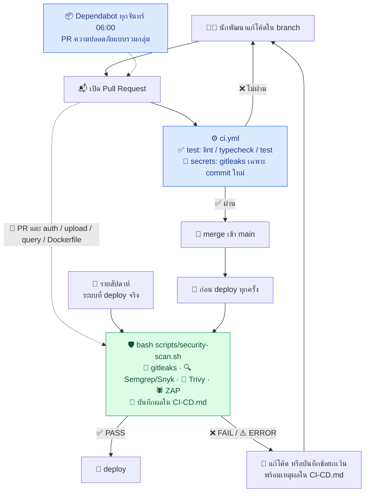
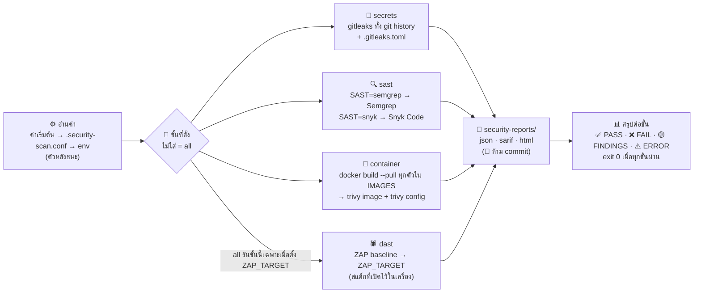

# 🛡️ ci-standards

มาตรฐาน CI/CD และความปลอดภัยที่ใช้ร่วมกันทุก repo ของ `nuttkku` — **v2.0 (2026-11-23)**

⚡ **สั้นๆ:** GitHub Actions ทำแค่งานเร็ว (test + หา secret ใน commit ใหม่) · สแกนความปลอดภัยหนัก (Trivy, Semgrep/Snyk Code, ZAP)
รันบนเครื่องด้วย Docker ผ่านสคริปต์เดียว · dependency ใช้ Dependabot

| หน้าที่ | เครื่องมือ | รันที่ |
|---|---|---|
| ✅ คุณภาพโค้ด | lint / typecheck / test ของ repo | GitHub Actions — ทุก PR |
| 🔑 secret (commit ใหม่) | gitleaks-action | GitHub Actions — ทุก PR |
| 🔑 secret (ทั้ง history) | gitleaks | เครื่อง — `security-scan.sh secrets` |
| 🔍 SAST | Semgrep หรือ Snyk Code | เครื่อง — `security-scan.sh sast` |
| 🐳 Container / Dockerfile | Trivy | เครื่อง — `security-scan.sh container` |
| 🕷️ DAST | OWASP ZAP baseline | เครื่อง — `security-scan.sh dast` |
| 📦 Dependency | Dependabot | GitHub |

## 🗺️ ภาพรวมการทำงาน

### 🔄 งานวิ่งจาก PR ถึง deploy อย่างไร
🟦 = GitHub รันอัตโนมัติ · 🟩 = รันบนเครื่องนักพัฒนาด้วย Docker


### 🔬 ข้างใน `security-scan.sh`

🐳 ทุกเครื่องมือรันเป็น container (image ปักเวอร์ชันไว้ในสคริปต์) — บนเครื่องไม่ต้องติดตั้งอะไรนอกจาก Docker กับ bash

## 📂 ไฟล์ใน repo นี้
| ไฟล์ | คืออะไร |
|---|---|
| [standards/CI-CD.md](standards/CI-CD.md) | มาตรฐานฉบับเต็ม — กติกา, รายการห้ามใช้, เมื่อไรต้องสแกน, เช็กลิสต์, ประวัติเวอร์ชัน |
| [templates/](templates) | ไฟล์ที่คัดลอกไปใช้ในแต่ละ repo (ด้านล่าง) |
| [docs/HISTORY.md](docs/HISTORY.md) | บันทึกการทำงาน — ทำอะไร เมื่อไร เพราะอะไร บทเรียน |
| [CLAUDE.md](CLAUDE.md) | กติกาสำหรับ Claude Code เวลาแก้ repo นี้ |

## 🚀 วิธีใช้งาน

### 1️⃣ สิ่งที่ต้องมีบนเครื่อง
- 🐳 **Docker** — Docker Desktop (Windows / macOS) หรือ Docker Engine (Linux) · ต้องเปิดไว้ก่อนรัน
- 💻 **bash** — Linux/macOS มีอยู่แล้ว · Windows ใช้ **Git Bash** (มากับ Git for Windows) หรือ WSL
- 🔍 **Snyk** (เฉพาะ repo ที่ตั้ง `SAST=snyk`) — `npm i -g snyk && snyk auth` ครั้งเดียว หรือ `export SNYK_TOKEN=...`
- ✨ ไม่ต้องติดตั้ง Trivy / Semgrep / ZAP / gitleaks — สคริปต์ดึง image ที่ปักเวอร์ชันไว้ให้เอง (ครั้งแรกใช้เวลาโหลดสักพัก)

### 2️⃣ เริ่มใช้ใน repo ใหม่
```bash
# ที่ราก repo ปลายทาง
base=https://raw.githubusercontent.com/nuttkku/ci-standards/main/templates
mkdir -p .github/workflows scripts
curl -fsSL $base/.github/workflows/ci.yml -o .github/workflows/ci.yml
curl -fsSL $base/.github/dependabot.yml   -o .github/dependabot.yml
curl -fsSL $base/scripts/security-scan.sh -o scripts/security-scan.sh
curl -fsSL $base/.security-scan.conf      -o .security-scan.conf
curl -fsSL $base/CI-CD.md                 -o CI-CD.md
printf '\nsecurity-reports/\n' >> .gitignore
printf '*.sh text eol=lf\n.security-scan.conf text eol=lf\n' >> .gitattributes
curl -fsSL $base/CLAUDE.md >> CLAUDE.md   # ให้ Claude Code ใน repo นั้นทำตามมาตรฐาน (ดูข้อ 6)
```
แล้วปรับ:
- `ci.yml` — คำสั่ง test ของ repo, `matrix` ถ้าเป็น monorepo, เวอร์ชัน Node ให้ตรงกับ Dockerfile
- `dependabot.yml` — `directories` ให้ครบทุกโฟลเดอร์ที่มี lockfile
- `.security-scan.conf` — image ที่ต้อง build, SAST ที่ใช้, เป้า ZAP (ข้อ 4)
- Settings → Code security → เปิด **Dependabot alerts** + **Dependabot security updates**
- รันสแกนครั้งแรก (ข้อ 3) กรอกผลและข้อยกเว้นใน `CI-CD.md` แล้วเปิด PR (ไม่ push เข้า main ตรง)

### 3️⃣ รันสแกน
```bash
bash scripts/security-scan.sh              # secrets + sast + container (+ dast ถ้าตั้ง ZAP_TARGET)
bash scripts/security-scan.sh sast         # เลือกขั้นเดียว: secrets | sast | container | dast
bash scripts/security-scan.sh secrets sast # หลายขั้น

docker compose up -d                       # DAST: เปิดสแต็กในเครื่องก่อน แล้ว
ZAP_TARGET=http://localhost:8080 bash scripts/security-scan.sh dast
```
ท้ายรันจะมีสรุป และ exit code ≠ 0 ถ้ามีขั้นที่ไม่ผ่าน:
```
== สรุป (2026-11-23 14:17, 15ea070)
  config:.                     PASS
  image:backend                PASS
  image:nginx                  FAIL
  sast                         PASS
  secrets                      PASS
  รายงาน: security-reports/
```
| ผล | ความหมาย | ทำอะไรต่อ |
|---|---|---|
| ✅ `PASS` | ไม่พบปัญหา | — |
| ❌ `FAIL` | พบ finding เกินเกณฑ์ | ดูรายละเอียดใน log ด้านบน / `security-reports/` แล้วแก้ หรือเพิ่มข้อยกเว้นพร้อมเหตุผล |
| 🟡 `FINDINGS (report-only)` | พบ finding แต่ repo ตั้งให้รายงานอย่างเดียว | ตรวจว่าไม่มีรายการใหม่ |
| ⚠️ `ERROR (exit N)` | เครื่องมือทำงานไม่สำเร็จ (เน็ต, login, Docker) | แก้สาเหตุแล้วรันขั้นนั้นซ้ำ — **ไม่ใช่ผ่าน** |

📁 รายงานเต็มอยู่ใน `security-reports/` (`gitleaks.json`, `semgrep.sarif` / `snyk-code.sarif`, `zap-baseline.html`) — มีรายละเอียดช่องโหว่ **ห้าม commit / ห้ามแชร์สาธารณะ**

⏰ **เมื่อไรต้องรัน:** ก่อน deploy ทุกครั้ง · รายสัปดาห์สำหรับระบบที่ deploy จริง · PR ที่แตะ auth / upload / query / Dockerfile (แนบบรรทัดสรุปใน PR) — แล้วอัปเดตตาราง "ผลสแกนล่าสุด" ใน `CI-CD.md`

### 4️⃣ ตั้งค่าต่อ repo — `.security-scan.conf`
```bash
# IMAGES: "ชื่อ|build context|target|trivy skip-dirs|trivy skip-files|ignorefile" (ช่องท้ายเว้นได้)
IMAGES=(
  "backend|./backend|production|/usr/local/lib/node_modules/npm"
  "frontend|./frontend"
)
TRIVY_CONFIG_PATHS=(.)        # โฟลเดอร์ที่ตรวจ Dockerfile / compose
SAST=semgrep                  # semgrep (ไม่ต้อง login) | snyk
SAST_FAIL=1                   # 0 = รายงานอย่างเดียว — เฉพาะเมื่อตรวจ finding ครบทุกจุดแล้ว
ZAP_TARGET=""                 # เช่น http://localhost:8080 (localhost แปลงเป็น host.docker.internal ให้)
ZAP_NETWORK=""                # หรือชื่อ docker network ของ compose + ใช้ชื่อ service ใน ZAP_TARGET
ZAP_RULES=.zap/rules.tsv      # finding ของ ZAP ที่ยอมรับ
ZAP_FAIL=1
```
ค่าเดี่ยว (`SAST`, `SAST_FAIL`, `ZAP_*`, `TRIVY_IGNOREFILE`) ตั้งผ่าน env ตอนรันได้ และชนะค่าในไฟล์ เช่น `SAST=semgrep bash scripts/security-scan.sh sast`

### 5️⃣ ข้อยกเว้น
ใส่ในไฟล์ของเครื่องมือนั้น **และเขียนเหตุผล + เงื่อนไขเอาออกใน `CI-CD.md` ทุกข้อ**

| เครื่องมือ | ไฟล์ |
|---|---|
| gitleaks | `.gitleaks.toml` (`[[allowlists]]`), `.gitleaksignore` (fingerprint) |
| Semgrep | `.semgrepignore`, `# nosemgrep: <rule-id>` ในบรรทัด |
| Snyk Code | `.snyk` (`exclude`) |
| Trivy | `.trivyignore.yaml` / `.trivyignore`, หรือ skip-dirs / skip-files ใน `IMAGES` |
| ZAP | `.zap/rules.tsv` (`<id>\tIGNORE\t(เหตุผล)`) |

### 6️⃣ ใช้กับ Claude Code (CLAUDE.md) 🤖
ต่อท้าย [templates/CLAUDE.md](templates/CLAUDE.md) เข้าไปใน `CLAUDE.md` ของแต่ละ repo (คำสั่ง `curl ... >> CLAUDE.md` ในข้อ 2)
Claude Code จะอ่านทุกครั้งที่เปิด repo และทำตามเอง:
- ไม่เพิ่ม job สแกนเข้า GitHub Actions · ใช้ `bash scripts/security-scan.sh` แทน
- รันสแกนก่อน deploy / ใน PR ที่แตะส่วนเสี่ยง แนบผลใน PR และอัปเดต `CI-CD.md`
- ไม่กด finding ให้เงียบโดยไม่บันทึกเหตุผล · ไม่แก้ `security-scan.sh` ใน repo ปลายทาง

สั่งงานได้ตรงๆ เช่น *"ย้าย repo นี้เข้ามาตรฐาน ci-standards v2"* หรือ *"รัน security scan แล้วสรุปสิ่งที่ต้องแก้"*

### 7️⃣ ปัญหาที่พบบ่อย 🩺
| อาการ | แก้ |
|---|---|
| `failed to connect to the docker API` | เปิด Docker Desktop แล้วรอจนขึ้น Running |
| `$'\r': command not found` | ไฟล์เป็น CRLF — เพิ่ม `.gitattributes` ตามข้อ 2 แล้ว `git rm --cached -r . && git reset --hard` |
| `ERROR` ตอน build / pull / npm (`ECONNRESET`, timeout) | เน็ตหลุด — รันขั้นนั้นซ้ำ |
| Snyk: `ต้อง login Snyk ก่อน` | `snyk auth` หรือ `export SNYK_TOKEN=...` หรือใช้ `SAST=semgrep` |
| ZAP เข้าเว็บในเครื่องไม่ได้ | ใช้ `ZAP_NETWORK=<network ของ compose>` + `ZAP_TARGET=http://<service>:<port>` |

## 🤔 ทำไมสแกนในเครื่อง
- 🏢 ระบบส่วนใหญ่อยู่ในเครือข่ายภายใน — runner ของ GitHub เข้าไม่ถึง (ZAP ทำไม่ได้)
- 🔐 ไม่ต้องแจก token ของ Snyk ให้ทุก repo และไม่ถูก "ข้ามเงียบๆ" เมื่อลืมตั้ง token
- ⏱️ ไม่กินนาที GitHub Actions (build image + สแกนเป็นงานที่ช้าที่สุดใน workflow เดิม) และเห็นผลเต็มทันทีบนเครื่อง

## ✏️ แก้มาตรฐาน
เปิด PR ที่ repo นี้ → ขยับเวอร์ชัน + "ประวัติการแก้ไข" ใน `standards/CI-CD.md` + บันทึกใน `docs/HISTORY.md` → ค่อยอัปเดต repo ต่างๆ
`security-scan.sh` ห้ามแก้ใน repo ปลายทาง — ปรับที่นี่แล้วคัดลอกไป (รายละเอียดใน [CLAUDE.md](CLAUDE.md))

⚠️ repo นี้เป็น public เพื่อให้ทุก repo (ทั้ง public และ private) และผู้ร่วมงานเปิดอ่านได้ — **ห้ามใส่ secret, hostname/IP ภายใน หรือข้อมูลองค์กร**
